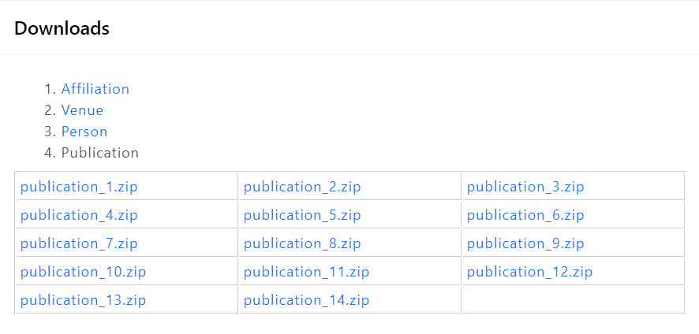
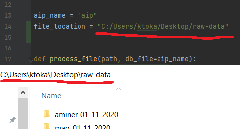
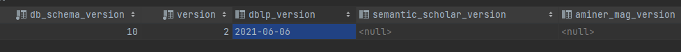

# Generating an AIP database

Disclaimer: The datasets are on the order of several 100 GBs and take a significant amount to process and import into a PostgreSQL database.

In order to update the database you must download all 4 data sources and parse them. 

**Upadte**: Semantic scholar API is now behind a license. Ensure your usage fits the license specification.

1. Create a new folder in the root of the repository where all the input files will be stored with the following command:
    ```sh
    $ export DOWNLOAD_DATE=$(date +'%d_%m_%Y')
    $ mkdir -p datasets/{dblp,s2-corpus,aminer,mag}_$DOWNLOAD_DATE
    ```

2. Download the [DBLP](https://dblp.uni-trier.de/xml/) dataset (`dblp.xml.gz` and `dblp.dtd`):
    ```sh
    $ wget -P datasets/dblp_$DOWNLOAD_DATE https://dblp.uni-trier.de/xml/{dblp.xml.gz,dblp.dtd}
    ```
   
3. **UPDATE**: aminer and mag datasets now seem to be combined into one graph. Name is kept for scripts to still function. Download the [Open Academic Graph](https://www.aminer.org/open-academic-graph) dataset which contains the Aminer and MAG papers using the following commands:

    ```sh
    $ wget -P datasets/aminer_$DOWNLOAD_DATE https://opendata.aminer.cn/dataset/oag_publication_{1..14}.zip
    ```

   This will download the following files:
   

4. Download the Semantic Scholar dataset by following the [instructions](https://api.semanticscholar.org/api-docs/datasets) to get the latest corpus and store the files in the `s2-corpus_$DOWNLOAD_DATE` directory. Note that this dataset has not been tested since the API has been licensed.

5. While the files are downloading (can take days), continue with next steps that do not depend on this.

6. Install PostgreSQL, and create with sufficient amount of privilages to create a new database. After completing that, modify `database_manager.py` with the appropriate credentials.

7. After downloading all the files, unzip them.

8. After making sure all files are unzipped and stored in the same folder, change line 14 in the `renew_data_locally.py` which is located in the parser folder, to the correct path of the folder you downloaded all the files to.

   

9. Finally, install `requirements.txt` into your python environment and run the `renew_data_locally.py` file.

10. After re-parsing the whole database, make sure to add the version dates of all the downloaded sources into the database.

   

11. Dump the database into a backup file `pg_dump aip > data.backup`